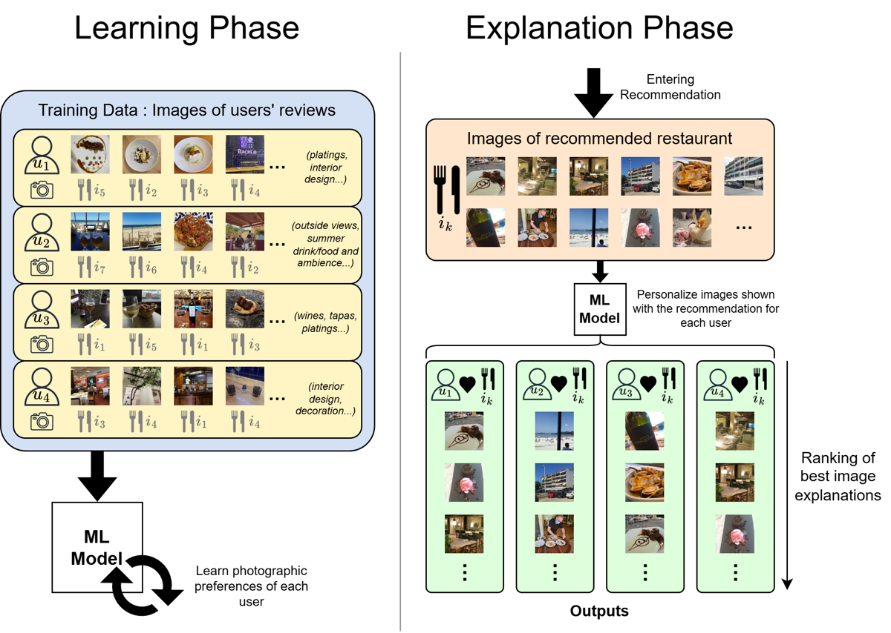

<div align="center">

# BRIE: Bayesian Ranking of Images for Explainability

**Sustainable transparency on recommender systems: personalized image explanations that outperform the state of the art with up to 64x smaller models and up to 75% lower CO₂ emissions.**

[](https://doi.org/10.1016/j.inffus.2024.102497)
[](https://doi.org/10.48550/arXiv.2308.01196)
[](LICENSE)
[](https://www.python.org/)

Jorge Paz Ruza et al. · Universidade da Coruña, CITIC



</div>

Official implementation of the paper *Sustainable transparency on recommender systems: Bayesian ranking of images for explainability*, published in [Information Fusion, vol. 111 (2024)](https://doi.org/10.1016/j.inffus.2024.102497) ([arXiv preprint](https://doi.org/10.48550/arXiv.2308.01196)).

## Overview

When a recommender system suggests an item (here, a restaurant), BRIE chooses which of the item's existing user-uploaded photos to show each user as a personalized visual explanation. It learns each user's photographic preferences from the images they have posted and ranks the candidate images with a matrix-factorization model trained with a Bayesian Pairwise Ranking (BPR) objective, instead of the surrogate binary classification used by prior work (ELVis, MF-ELVis).

- **More accurate:** best results on all six real-world datasets (Gijón, Barcelona, Madrid, New York, Paris, London) for Recall@10, NDCG@10 and AUC.
- **Smaller:** up to 64x fewer parameters than the state-of-the-art models.
- **Greener:** up to 75% lower CO₂ emissions in training and inference, tracked with [CodeCarbon](https://codecarbon.io/).

<details>
<summary>Abstract</summary>

Recommender Systems have become crucial in the modern world, commonly guiding users towards relevant content or products, and having a large influence over the decisions of users and citizens. However, ensuring transparency and user trust in these systems remains a challenge; personalized explanations have emerged as a solution, offering justifications for recommendations. Among the existing approaches for generating personalized explanations, using existing visual content created by users is a promising option to maximize transparency and user trust. State-of-the-art models that follow this approach, despite leveraging highly optimized architectures, employ surrogate learning tasks that do not efficiently model the objective of ranking images as explanations for a given recommendation; this leads to a suboptimal training process with high computational costs that may not be reduced without affecting model performance. This work presents BRIE, a novel model where we leverage Bayesian Pairwise Ranking to enhance the training process, allowing us to consistently outperform state-of-the-art models in six real-world datasets while reducing its model size by up to 64 times and its CO<sub>2</sub> emissions by up to 75% in training and inference.

</details>

## Installation

```bash
git clone https://github.com/Kominaru/BRIE.git
cd BRIE
python -m venv .venv && source .venv/bin/activate   # Windows: .venv\Scripts\activate
# Optional but recommended on GPU machines: install the CUDA build of PyTorch first
# (https://pytorch.org/get-started/locally/)
pip install .
```

This installs the `brie` Python package and the `brie` command. Optional extras: `".[images]"` (compute image features from image files), `".[paper]"` (figures of the paper scripts), `".[tune]"` (hyperparameter search with Ray Tune) and `".[dev]"` (tests). Run the tests with `pip install ".[dev]" && pytest`. To run only the paper scripts from the repository root, `pip install -r requirements.txt` is enough.

The code was developed and tested with Python 3.10 and CUDA 11.8. The exact environment used for the paper is frozen in `requirements-lock.txt` (`torch==2.4.1+cu118`, install it from the [PyTorch wheel index](https://download.pytorch.org/whl/cu118)).

## Using BRIE on your own data

BRIE ranks the images of an item (here, the photos of a restaurant) for a given user, after learning each user's photographic preferences from the images they authored. You need two things:

| Input | Format |
|---|---|
| **Interactions** | A table with one row per image authored by a user: `user` (any id), `image` (image id) and `item` (what the image belongs to, e.g. the restaurant). |
| **Image features** | One feature vector per image, as a NumPy array `(n_images, n_features)` where row `i` is image `i`, or a DataFrame indexed by image id. The paper uses 1536-dimensional Inception-ResNet-v2 embeddings, but any size works. |

```python
import pandas as pd
from brie import BRIERanker

interactions = pd.DataFrame({
    "user":  ["ana", "ana", "bea", "bea", "carlos", "carlos"],
    "image": [0, 1, 2, 3, 4, 5],
    "item":  ["pizzeria", "bar", "pizzeria", "bar", "pizzeria", "bar"],
})
image_features = ...   # array of shape (6, n_features)

ranker = BRIERanker().fit(interactions, image_features)   # defaults = paper hyperparameters

# Rank the photos of one item for one user (best first)
ranker.rank("ana", image_features[[0, 2, 4]])
#    image     score
# 0      2  0.81...

ranker.save("brie.pt")
ranker = BRIERanker.load("brie.pt")
```

`BRIERanker(d=64, dropout=0.75, lr=1e-3, epochs=15, batch_size=2**14)` defaults are the hyperparameters of the paper; see the docstring for all options. A complete runnable example on synthetic data is in [`examples/synthetic_example.py`](examples/synthetic_example.py).

Things to know:

- BRIE learns one embedding per user, so it can only rank for users seen in training (no cold start), and every user needs at least one image.
- The `item` column is used, as in the paper, to sample negative images from the same item (authored by other users) in addition to random ones. At least one item needs images from two or more users.
- `rank` returns the images in `image_features`: the row number of an array, or the index of a DataFrame, is reported as `image`. Scores are in [0, 1].
- Fix `seed=` for reproducible training.

### Command line

The same workflow from CSV and `.npy` files (`interactions.csv` has the columns `user,image,item`; row `i` of `features.npy` is image `i`):

```bash
brie fit --interactions interactions.csv --features features.npy --out brie.pt
brie rank --model brie.pt --user ana --features features.npy --images 0 2 4 --top-k 3
```

### Image features from image files

If you only have image files, `extract_image_features` computes embeddings with the same architecture as the paper (Inception-ResNet-v2, `pip install ".[images]"`):

```python
from brie.features import extract_image_features

image_features = extract_image_features(["photo1.jpg", "photo2.jpg"])   # (2, 1536)
```

### Using the pre-trained paper models

Checkpoints from the [pre-trained models](#pre-trained-models) section can be loaded with the same API. Users are the integer ids of the Zenodo datasets:

```python
ranker = BRIERanker.from_lightning_checkpoint("models/barcelona/BRIE/last.ckpt")
ranker.rank(user=12, image_features=features_of_a_restaurant)
```

## Reproducing the paper

The scripts below (`main.py`) train and evaluate BRIE and the baselines exactly as in the paper.

## Data

The six datasets (Gijón, Barcelona, Madrid, New York, Paris, London) are available on [Zenodo](https://zenodo.org/record/5644892). Place them in a `data` folder with one subfolder per city, e.g. `data/barcelona/data_10+10/IMG_TRAIN`. City names are lowercase: `gijon`, `barcelona`, `madrid`, `newyork`, `paris`, `london`.

## Pre-trained models

Pre-trained BRIE models for every city are available on [Google Drive](https://drive.google.com/drive/folders/1y5HlMk3tyQyW2nNEeaRBR5rpnVJwh5K3). Place each checkpoint at `models/CITY/BRIE/`, e.g. `models/barcelona/BRIE/last.ckpt`.

Checkpoints are loaded as `last.ckpt` when you pass `--no_validation` (as in the paper setup) and as `best-model.ckpt` otherwise.

## Quickstart

Evaluate a pre-trained BRIE model against the baselines on one city:

```bash
python main.py --stage test --city barcelona --model BRIE --no_validation --batch_size 2**14 --workers 4
```

This reports MRecall@10, MNDCG@10 and MAUC for BRIE and the random (RND) and centroid (CNT) baselines, and saves the figures in `figures/` and `docs/`.

## Usage

### Training

```bash
python main.py --stage train --city CITY --model BRIE --max_epochs EPOCHS \
    [--batch_size BATCH_SIZE] [--lr LR] [--dropout DROPOUT] -d DIMS --workers NUM_WORKERS \
    [--early_stopping] [--no_validation]
```

Batch sizes can be written as powers, e.g. `2**14`. To train BRIE with the hyperparameters used in the paper:

```bash
python main.py --stage train --city barcelona --model BRIE --max_epochs 15 \
    --batch_size 2**14 --lr 0.001 --dropout 0.75 -d 64 --workers 4 --no_validation
```

Checkpoints are written to `models/CITY/BRIE/`. Add `--log_to_csv` to log training curves, time and CO₂ emissions to `csv_logs/`.

### Evaluation and comparison

```bash
python main.py --stage test --city CITY --model MODEL_NAME... [--batch_size BATCH_SIZE] --workers NUM_WORKERS
```

Several trained models can be compared at once by listing them after `--model`. Supported models are `BRIE`, `ELVis` and `MF_ELVis`. For example, to compare BRIE against ELVis:

```bash
python main.py --stage test --city barcelona --model BRIE ELVis --batch_size 2**14 --workers 4
```

### Hyperparameter tuning

`--stage tune` runs a [Ray Tune](https://docs.ray.io/en/latest/tune/index.html) search over embedding size and dropout; `--num_models` sets the number of trials.

## Results

BRIE outperforms the best baseline on all six datasets (for example, MRecall@10 of 0.630 versus 0.597 for ELVis in Barcelona). The full table also compares against MF-ELVis and two basic baselines (random, RND, and user-centroid, CNT).

<details>
<summary>Full results for the six datasets (best in bold)</summary>

<div align="center">

|          | **Gijón**   |           |           |   | **Barcelona** |           |           |   | **Madrid** |           |           |
|----------|-------------|----------:|----------:|---|---------------|----------:|----------:|---|------------|----------:|----------:|
|          | MRecall@10  | MNDCG@10  | MAUC      |   | MRecall@10    | MNDCG@10  | MAUC      |   | MRecall@10 | MNDCG@10  | MAUC      |
| RND      |       0.373 |     0.185 |     0.487 |   |         0.409 |     0.186 |     0.502 |   |      0.374 |     0.171 |     0.499 |
| CNT      |       0.464 |     0.218 |     0.546 |   |         0.443 |     0.219 |     0.554 |   |      0.420 |     0.203 |     0.557 |
| ELVis    |       0.521 |     0.262 |     0.596 |   |         0.597 |     0.327 |     0.631 |   |      0.572 |     0.314 |     0.638 |
| MF-ELVis |       0.538 |     0.285 |     0.592 |   |         0.557 |     0.293 |     0.596 |   |      0.528 |     0.279 |     0.601 |
| BRIE     |   **0.607** | **0.333** | **0.643** |   |     **0.630** | **0.368** | **0.663** |   |  **0.612** | **0.348** | **0.673** |
|          |             |           |           |   |               |           |           |   |            |           |           |
|          | **Newyork** |           |           |   | **Paris**     |           |           |   | **London** |           |           |
|          | MRecall@10  | MNDCG@10  | MAUC      |   | MRecall@10    | MNDCG@10  | MAUC      |   | MRecall@10 | MNDCG@10  | MAUC      |
| RND      |       0.374 |     0.168 |     0.502 |   |         0.459 |     0.209 |     0.502 |   |      0.342 |     0.155 |     0.500 |
| CNT      |       0.431 |     0.217 |     0.563 |   |         0.499 |     0.245 |     0.557 |   |      0.400 |     0.200 |     0.562 |
| ELVis    |       0.553 |     0.304 |     0.637 |   |         0.643 |     0.352 |     0.630 |   |      0.530 |     0.293 |     0.629 |
| MF-ELVis |       0.516 |     0.276 |     0.602 |   |         0.606 |     0.323 |     0.596 |   |      0.531 |     0.267 |     0.597 |
| BRIE     |   **0.598** | **0.341** | **0.677** |   |     **0.669** | **0.391** | **0.666** |   |  **0.563** | **0.318** | **0.665** |

</div>

</details>

- Results for ELVis and MF-ELVis were obtained by running the code of the original authors: [ELVis](https://github.com/pablo-pnunez/ELVis), [MF-ELVis](https://github.com/Kominaru/tfg-komi).
- Sustainability comparisons (training time and emissions, model size, inference time and emissions) are reported in the paper.

## Citation

If you use this code or the BRIE model, please cite the journal paper (GitHub's "Cite this repository" button uses [`CITATION.cff`](CITATION.cff)):

```bibtex
@article{paz2024sustainable,
  title     = {Sustainable transparency on recommender systems: Bayesian ranking of images for explainability},
  author    = {Paz-Ruza, Jorge and Alonso-Betanzos, Amparo and Guijarro-Berdi{\~n}as, Bertha and Cancela, Brais and Eiras-Franco, Carlos},
  journal   = {Information Fusion},
  volume    = {111},
  pages     = {102497},
  year      = {2024},
  month     = nov,
  publisher = {Elsevier},
  doi       = {10.1016/j.inffus.2024.102497}
}
```

## Authors

**Jorge Paz Ruza** [](https://orcid.org/0000-0002-7869-1070) [](https://www.linkedin.com/in/jorge-paz-ruza-646141186/)<br>
**Amparo Alonso Betanzos** [](https://orcid.org/0000-0003-0950-0012) [](https://www.linkedin.com/in/amparo-alonso-80516211/)<br>
**Bertha Guijarro Berdiñas** [](https://www.linkedin.com/in/bertha-guijarro-b4906b28/)<br>
**Brais Cancela** [](https://orcid.org/0000-0002-2295-4142) [](https://www.linkedin.com/in/cancelabarizo/)<br>
**Carlos Eiras Franco** [](https://orcid.org/0000-0001-6322-7593) [](https://www.linkedin.com/in/carloseiras/)

Universidade da Coruña, CITIC (A Coruña, Spain).

## License

Released under the [MIT License](LICENSE). The paper is open access under [CC BY 4.0](https://creativecommons.org/licenses/by/4.0/), and the overview figure is reproduced from it.

## Contact

Questions, issues and collaboration ideas are welcome: open a [GitHub issue](https://github.com/Kominaru/BRIE/issues) or write to Jorge Paz Ruza at [j.ruza@udc.es](mailto:j.ruza@udc.es).

## Acknowledgements

This research was funded by MICIU/AEI/10.13039/501100011033 and ESF+ (grant FPU21/05783), ERDF A way of making Europe (PID2019-109238GB-C22) and ERDF/EU (PID2021-128045OA-I00), and by the Xunta de Galicia (Grant ED431C 2022/44) with European Union ERDF funds. CITIC is funded by the Consellería de Cultura, Educación e Universidade of the Xunta de Galicia (Grant ED431G 2019/01).
